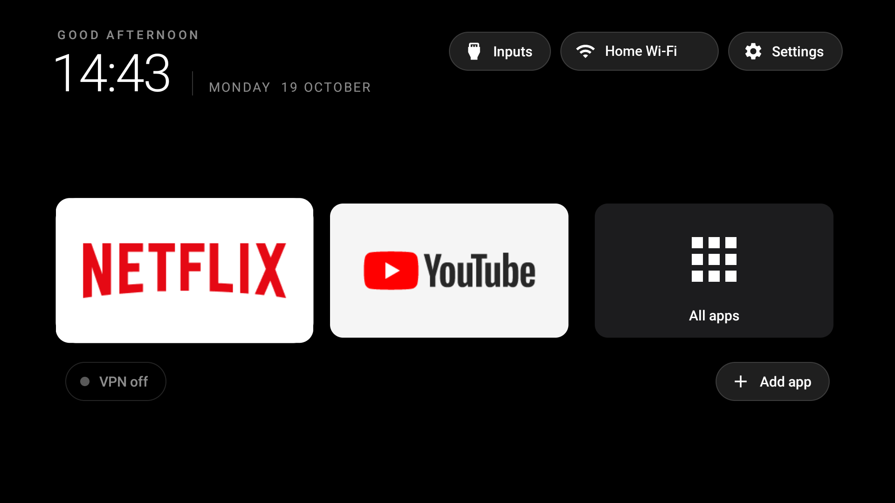

# TV Home

A fast, plain home screen for a slow Android TV. Black background, a header with the time, and a dock with the apps you actually use.



*A real screenshot from an Android 11 TV with 1.4 GB of RAM. The Wi-Fi name is replaced with a generic label.*

- **Header:** greeting, clock, date, and three pills: Inputs, Wi-Fi (shows the network name), Settings.
- **Dock:** Netflix, YouTube, and an All apps tile that opens every other app A to Z. The row scrolls sideways when it gets long.
- **Add app:** the pill at the bottom-right of the row opens a picker and pins the app you choose. Hold OK on a tile to remove it. Your choices are saved on the TV.
- **VPN status:** a chip at the bottom-left of the row shows "VPN off", or "VPN · United States" with a green dot while a VPN is on. Detecting a VPN is offline. The country comes from one request to a free IP lookup service (api.country.is, then ipwho.is as a fallback), made only while a VPN is up and once per VPN connection, so the service sees the VPN's address and never your real one.
- **Lean on purpose:** no libraries, no animations beyond a small scale on focus, and no network use at all while the VPN is off.

Forked from [Gathin23/cleanyourtv](https://github.com/Gathin23/cleanyourtv) (MIT) and inspired by [manojm321/jain-tv-launcher](https://github.com/manojm321/jain-tv-launcher). The launcher code is rewritten; the ADB install, debloat and restore tooling and the TV lists in `examples/` come from upstream.

## Change the default dock

The dock starts from the list in `launcher/app/src/main/res/values/config.xml`. Once you add or remove an app on the TV, your saved list wins and this file is only the starting point. To go back to the file's list, run `pm clear com.minimaltv.home` over ADB. Find package names with:

```bash
TV_HOST=<tv ip> tools/venv/bin/python -I tools/tv.py 'pm list packages'
```

## Build and install

On the TV: Settings, Device Preferences, About, press OK on **Build** seven times, then Developer options, turn on **USB debugging** (and **Network debugging** if listed).

On the Mac: JDK 17 and the Android SDK (platform 34, build-tools 34), then:

```bash
python3 -m venv tools/venv
tools/venv/bin/pip install -r tools/requirements.txt
TV_HOST=<tv ip> launcher/build-and-install.sh
```

Accept the "Allow USB debugging?" prompt on the TV. The script builds the APK, installs it, makes it the Home app, and disables the stock launcher (disabled, never uninstalled).

## Debloat and undo

Pick or write a list (one package per line, see `examples/`), then:

```bash
TV_HOST=<tv ip> tools/disable.sh <list>
```

To undo only that list and keep this launcher as Home, enable the packages again over ADB:

```bash
TV_HOST=<tv ip> tools/venv/bin/python -I tools/tv.py 'for p in <package> <package>; do pm enable $p; done'
```

`tools/restore.sh <list>` is the full way back to stock: it re-enables the list, re-enables the stock launcher and makes it Home again. See `docs/TROUBLESHOOTING.md` if Home does not switch.

## Licence

MIT, see `LICENSE`.
